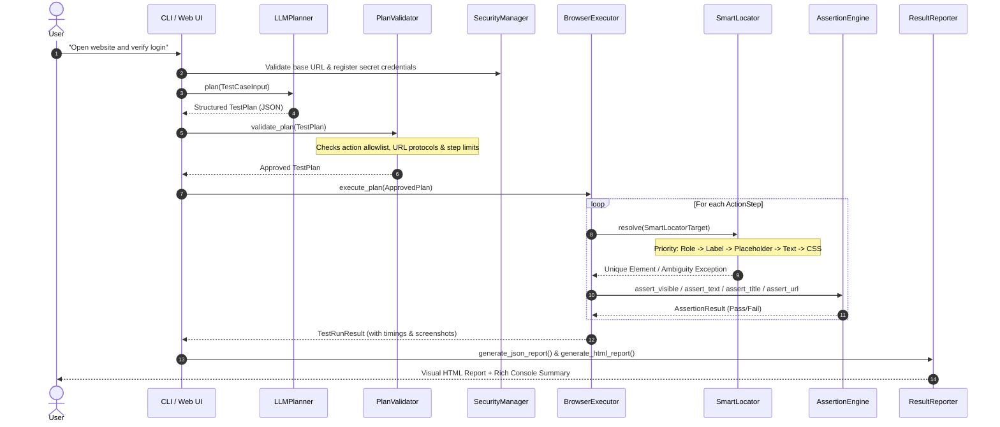

# AI Natural Language Test Automation

[](https://www.python.org/downloads/)
[](https://playwright.dev/python/)
[](https://docs.pydantic.dev/)
[](https://pytest.org/)
[](LICENSE)

An enterprise-grade, generic AI-powered browser test automation engine. It converts plain-English test instructions into structured, executable test plans via Large Language Models (LLMs), validates every action through strict Pydantic schemas, executes them using Playwright, and produces verifiable PASS/FAIL evidence with embedded screenshots, timing diagnostics, and multi-format reports.

> **Design Principle:** This system is strictly generic. It contains zero hardcoded site-specific selectors, credentials, workflows, or conditional branches for any single website.

---

## 📑 Table of Contents

- [Core Architecture](#-core-architecture)
- [The 9 Decoupled Components](#-the-9-decoupled-components)
- [Architecture Workflow Diagram](#-architecture-workflow-diagram)
- [Supported Action Registry](#-supported-action-registry)
- [SmartLocator & Ambiguity Handling](#-smartlocator--ambiguity-handling)
- [Security & Execution Safeguards](#-security--execution-safeguards)
- [Installation & Quick Start](#-installation--quick-start)
- [CLI Usage Guide](#-cli-usage-guide)
- [Interactive Streamlit Web UI](#-interactive-streamlit-web-ui)
- [Verified Demonstrations](#-verified-demonstrations)
  - [1. PHPTravels Demo Flow](#1-phptravels-demo-flow)
  - [2. Generic E-Commerce Flow (BooksToScrape)](#2-generic-e-commerce-flow-bookstoscrape)
  - [3. Generic Smoke Flow (Example Domain)](#3-generic-smoke-flow-example-domain)
- [Automated Testing Suite](#-automated-testing-suite)
- [Approach & Limitations Note](#-approach--limitations-note)
- [Project Structure](#-project-structure)

---

## 🏛️ Core Architecture

The architecture enforces a strict boundary between probabilistic LLM natural language generation and deterministic browser execution:

```
[ Natural Language Input ]
           │
           ▼
   [ 1. TestCaseInput ]
           │
           ▼
    [ 2. LLMPlanner ]  ◄─── Configurable LLM (Mock / Gemini / OpenAI)
           │
           ▼
    [ TestPlan (JSON) ]
           │
           ▼
  [ 3. PlanValidator ]  ◄─── Allowlist, Schema bounds, SecurityManager
           │ (Approved Plan)
           ▼
 [ 4. BrowserExecutor ] ◄─── Playwright (Sync Engine)
     ├── [ 5. SmartLocator ]   (Role -> Label -> Placeholder -> Text -> TestID -> CSS)
     └── [ 6. AssertionEngine ] (Visible, Text, URL, Title)
           │
           ▼
  [ 7. ResultReporter ]  ───► JSON Report + Standalone HTML + Rich Terminal Table
```

---

## 🧩 The 9 Decoupled Components

| # | Component | Location | Responsibility |
|---|---|---|---|
| **1** | `TestCaseInput` | `planner/models.py` | Encapsulates instruction, validated base URL, optional credentials, and execution settings. |
| **2** | `LLMPlanner` | `planner/llm/` | Translates natural language into structured JSON conforming to `TestPlan`. Supports Gemini, OpenAI, and deterministic Mock provider. |
| **3** | `PlanValidator` | `planner/validator.py` | Verifies every action against an allowlist, checks mandatory parameters, validates URL schemes, and enforces step limits before browser launch. |
| **4** | `BrowserExecutor` | `browser/executor.py` | Launches Playwright browser sessions, handles auto-waiting, coordinates execution, tracks millisecond durations, and captures failure screenshots. |
| **5** | `SmartLocator` | `locators/smart_locator.py` | Prioritizes accessibility-first locators (ARIA roles, labels, placeholders, semantic text, test IDs) with strict ambiguity detection. |
| **6** | `AssertionEngine` | `assertions/engine.py` | Verifies DOM visibility, text contents, URLs, and page titles. Guarantees that tests never report PASS unless all assertions strictly pass. |
| **7** | `ResultReporter` | `reporting/reporter.py` | Generates structured JSON reports, standalone HTML reports with base64-embedded screenshots, and formatted Rich terminal summaries. |
| **8** | `ConfigManager` | `config/settings.py` | Centralizes runtime settings via `pydantic-settings` from `.env` files and environment variables. |
| **9** | `SecurityManager` | `security/manager.py` | Restricts navigation to HTTP/HTTPS, enforces domain boundaries, masks sensitive credentials in logs/reports, and prevents dynamic code execution (`eval`/`exec`). |

---

## 📊 Architecture Workflow Diagram



---

## ⚡ Supported Action Registry

Every step executed by the engine must be an instance of the `ActionType` allowlist:

| Action | Required Arguments | Purpose |
|---|---|---|
| `navigate` | `url` | Navigates to an authorized HTTP/HTTPS destination |
| `click` | `target` | Clicks an accessible button, link, or element |
| `fill` | `target`, `value` | Types text into an input field or textarea |
| `select_option` | `target`, `select_values` or `value` | Selects one or more dropdown options |
| `check` | `target` | Checks a checkbox or radio button |
| `uncheck` | `target` | Unchecks a checkbox |
| `press` | `value` (e.g. `'Enter'`, `'Tab'`) | Simulates keyboard key presses |
| `wait_for` | `target` or `wait_state` or `timeout_ms` | Waits for element visibility or lifecycle event |
| `assert_visible` | `target` | Asserts target element is visible in the viewport |
| `assert_text` | `target`, `expected_text` | Asserts element text matches (exact or substring) |
| `assert_url` | `url` or `expected_text` | Asserts current browser URL contains pattern |
| `assert_title` | `expected_title` | Asserts page document title matches expectation |
| `screenshot` | `screenshot_name` (optional) | Captures visual page state for audit evidence |

> **Security Rule:** Neither `eval()`, `exec()`, shell commands, nor dynamically generated Python files are ever used to execute model output. The engine parses declarative data only.

---

## 🎯 SmartLocator & Ambiguity Handling

The `SmartLocator` engine prioritizes semantic accessibility over fragile XPath/CSS selectors:

1. **Role + Accessible Name:** `page.get_by_role("button", name="Login")`
2. **Explicit Test IDs:** `page.get_by_test_id("submit-button")`
3. **Form Labels:** `page.get_by_label("Username")`
4. **Input Placeholders:** `page.get_by_placeholder("Enter your password")`
5. **Exact / Substring Text:** `page.get_by_text("Welcome back")`
6. **Semantic CSS / XPath Fallback:** `input[name="user"]`, `.submit-btn`

### Ambiguity Detection:
If a locator matches multiple interactive elements when unique interaction is expected:
1. `SmartLocator` probes the match count.
2. It attempts a `visible=true` filter to discard hidden clones.
3. If still ambiguous, execution halts immediately and raises `LocatorAmbiguityError` detailing:
   - Match count
   - Candidate DOM snippets (tags, classes, sample text)
   - Diagnostic guidance for the user or test planner

---

## 🛡️ Security & Execution Safeguards

- **Zero Arbitrary Code Execution:** LLM produces strictly JSON matching `TestPlan`. No model code is interpreted.
- **Protocol Allowlist:** Only `http://` and `https://` schemes are permitted. Malicious schemes such as `file://`, `javascript:`, `data:`, `ftp:`, and `chrome:` are blocked by `SecurityManager`.
- **Credential Protection & Log Masking:** Passwords registered in `TestCaseInput` are substituted securely via placeholder tokens (`{{PASSWORD}}`) and masked with `********` across all terminal logs, JSON files, and HTML reports.
- **Resource Limits:**
  - `MAX_ACTIONS`: Default limit of 30 steps prevents infinite execution loops.
  - `MAX_DURATION_SEC`: Hard watchdog timeout (default 120s).
  - Explicit step-level timeouts (default 10,000ms) with auto-waiting.
- **Strict Verification:** The engine **never** reports `PASS` unless all assertions genuinely succeed. Any assertion failure immediately transitions the step to `FAIL`, captures a failure screenshot, skips downstream actions, and writes diagnostic records.

---

## 🚀 Installation & Quick Start

### 1. Clone & Setup Virtual Environment
```bash
git clone https://github.com/your-username/ai-natural-language-test-automation.git
cd ai-natural-language-test-automation

python -m venv .venv
# Windows:
.venv\Scripts\activate
# Linux/macOS:
# source .venv/bin/activate
```

### 2. Install Dependencies & Playwright Browsers
```bash
pip install -r requirements.txt
playwright install chromium
```

### 3. Configure Environment
```bash
cp .env.example .env
```
*(Default configuration uses `LLM_PROVIDER=mock`, which runs completely offline without any API keys required!)*

---

## 💻 CLI Usage Guide

### Basic Smoke Test
```bash
python -m app --url "https://example.com" --test "Open the website and verify its title contains 'Example Domain' and header is visible"
```

### Visible Browser Demonstration (Watch actions in real time)
```bash
python -m app --url "https://books.toscrape.com" --test "Open the bookstore catalogue and verify the page title contains 'All products' and books are visible" --slow-mo 300
```

### Authenticated Test (with Secure Credentials)
```bash
python -m app \
  --url "https://the-internet.herokuapp.com/login" \
  --test "Open the login page, enter username and password, click login, and verify success" \
  --credentials '{"username":"tomsmith","password":"SuperSecretPassword!"}'
```

### Interactive Mode
```bash
python -m app --interactive
```
Launches an interactive prompt guiding through URL, test prompt, optional credentials, headless choice, and pacing.

### Command-Line Arguments Reference
| Option | Short | Description |
|---|---|---|
| `--url` | `-u` | Target HTTP/HTTPS URL |
| `--test` | `-t` | Plain-English instruction |
| `--credentials` | `-c` | JSON credentials string (e.g. `'{"username":"...","password":"..."}'`) |
| `--provider` | | Provider override: `mock`, `gemini`, or `openai` |
| `--headless` | | Run in headless mode (default: False for demonstrations) |
| `--slow-mo` | | Delay in milliseconds between Playwright actions (default: 250ms) |
| `--interactive` | `-i` | Launch interactive wizard |
| `--env-file` | | Path to custom `.env` file |

---

## 🌐 Interactive Streamlit Web UI

A full-featured graphical user interface is included:

```bash
streamlit run app/web_ui.py
```

### Streamlit Features:
- **Preset Test Selectors:** One-click presets for PHPTravels, BooksToScrape, Example Domain, and Local Integration tests.
- **Provider Switcher:** Switch between Mock (offline), Gemini, and OpenAI backends.
- **Real-Time Visual Execution:** Toggle Headless mode on/off and adjust execution pacing slider.
- **Evidence Viewer:** View embedded screenshots, step durations, and error diagnostics directly in browser tabs.
- **Report Downloader:** Browse and download standalone HTML reports from all prior runs.

---

## 🧪 Verified Demonstrations

### 1. PHPTravels Demo Flow
- **Site Inspected:** `https://phptravels.com/demo`
- **Current Flow Findings:** The current live PHPTravels demo page provides direct access to test travel booking features and demo request forms ("Get your demo access"). It no longer exposes legacy static credentials (`admin@phptravels.com` / `demouser@phptravels.com`) on this page.
- **Executed Flow:** Genuine non-authenticated live verification of page title and demo access sections.
- **Execution Command:**
  ```bash
  python -m app --url "https://phptravels.com/demo" --test "Open the PHPTravels demo page and verify the title contains 'PHPTRAVELS' and the demo access section is visible" --headless
  ```
- **Result:** `PASS` (4/4 steps passed in 10.83s). Evidence saved to `reports/report_9e95e040-276b-4c28-8ebe-d58f9812a541.html`.

### 2. Generic E-Commerce Flow (BooksToScrape)
- **Target URL:** `https://books.toscrape.com`
- **Execution Command:**
  ```bash
  python -m app --url "https://books.toscrape.com" --test "Open the bookstore catalogue and verify the page title contains 'All products' and books are visible" --headless
  ```
- **Result:** `PASS` (4/4 steps passed in 26.94s). Evidence saved to `reports/report_852c68ce-50d2-486b-98ee-c968b880fde8.html`.

### 3. Generic Smoke Flow (Example Domain)
- **Target URL:** `https://example.com`
- **Execution Command:**
  ```bash
  python -m app --url "https://example.com" --test "Open the website and verify its title contains 'Example Domain' and header is visible" --headless
  ```
- **Result:** `PASS` (4/4 steps passed in 27.28s). Evidence saved to `reports/report_12e314e8-9ebf-4696-b85f-691ca7a516dc.html`.

---

## 🔬 Automated Testing Suite

The test suite contains **101 automated tests** covering unit, security, error handling, and browser integration scenarios:

```bash
# Run all tests
pytest -v

# Run unit tests only (instantaneous, offline)
pytest tests/test_plan_validator.py tests/test_security_manager.py tests/test_llm_planner.py tests/test_result_reporter.py tests/test_smart_locator.py tests/test_assertion_engine.py -v

# Run local browser integration tests (spins up local HTTP server fixture)
pytest tests/test_integration_local.py -v
```

### Test Coverage Breakdown:
1. `test_plan_validator.py`: Allowlisted action checks, parameter validation, URL protocol filtering, step count limits.
2. `test_security_manager.py`: Protocol enforcement (rejects `file:`, `javascript:`, `data:`), domain bounding, dynamic code rejection (`eval`, `exec`), and secret masking.
3. `test_llm_planner.py`: Mock LLM response parsing, markdown code block stripping, malformed JSON handling, credential substitution, missing credentials clarification.
4. `test_smart_locator.py`: Semantic role, label, placeholder, and test ID resolution; explicit disambiguation index; `LocatorAmbiguityError` and `LocatorNotFoundError` triggers.
5. `test_assertion_engine.py`: Visibility, text equality/containment, URL substring/exact match, page title verification.
6. `test_result_reporter.py`: JSON generation, standalone HTML report rendering, and Rich terminal summary formatting.
7. `test_integration_local.py`: Live Playwright execution against local HTML page verifying login forms, counters, navigation, and genuine failure detection (never fabricating PASS).

---

## 📝 Approach & Limitations Note

### Engineering Approach
1. **Deterministic Execution over Code Synthesis:** Rather than allowing an LLM to generate unstructured Python/Playwright scripts (which introduces arbitrary code execution risks and fragile locator hallucination), our architecture uses LLMs exclusively as structured planners emitting schema-validated JSON actions.
2. **Accessibility-First Locators:** By prioritizing ARIA roles, labels, and text over raw XPath or CSS classes, tests are resilient to styling updates and layout changes.
3. **Fail-Fast Safety:** If an element is ambiguous or mandatory credentials are not provided, the engine halts cleanly with a diagnostic rather than blindly clicking random elements.

### Current Limitations & Production Roadmap
- **Complex Multi-Tab / Multi-Window Contexts:** The current executor focuses on single-tab workflows; multi-window popups require window tracking extension.
- **Canvas and WebGL Elements:** Elements rendered entirely in HTML5 Canvas lack accessible DOM nodes and require visual/coordinate-based fallback strategies.
- **CAPTCHAs and Bot Detection:** Third-party bot detection gates (e.g. Cloudflare Turnstile, reCAPTCHA) cannot and should not be bypassed automatically; human-in-the-loop pause is the recommended design for gated staging environments.

---

## 📁 Project Structure

```
ai-natural-language-test-automation/
├── app/
│   ├── __init__.py
│   ├── __main__.py             # CLI entry point (python -m app)
│   ├── runner.py               # Orchestrator binding all 9 components
│   └── web_ui.py               # Interactive Streamlit Web Application
├── config/
│   ├── __init__.py
│   └── settings.py             # Pydantic Settings & environment manager
├── security/
│   ├── __init__.py
│   └── manager.py              # Credential masking & protocol allowlist
├── planner/
│   ├── __init__.py
│   ├── models.py               # Strict Pydantic schemas (TestPlan, ActionStep)
│   ├── validator.py            # PlanValidator & constraint enforcement
│   └── llm/
│       ├── __init__.py
│       ├── llm_planner.py      # LLM prompt orchestration & parsing
│       └── providers/
│           ├── base.py         # BaseLLMProvider interface
│           ├── mock_provider.py # Offline deterministic Mock LLM
│           ├── gemini_provider.py # Google Gemini provider
│           └── openai_provider.py # OpenAI / compatible provider
├── browser/
│   ├── __init__.py
│   └── executor.py             # Playwright browser automation engine
├── locators/
│   ├── __init__.py
│   ├── exceptions.py           # LocatorAmbiguityError, LocatorNotFoundError
│   └── smart_locator.py        # Accessibility-first locator resolution
├── assertions/
│   ├── __init__.py
│   └── engine.py               # AssertionEngine (visible, text, url, title)
├── reporting/
│   ├── __init__.py
│   └── reporter.py             # ResultReporter (JSON, HTML, Rich console)
├── tests/
│   ├── __init__.py
│   ├── conftest.py             # Shared fixtures & local HTTP server
│   ├── sample_page.html        # Local integration test fixture
│   ├── test_plan_validator.py
│   ├── test_security_manager.py
│   ├── test_llm_planner.py
│   ├── test_result_reporter.py
│   ├── test_smart_locator.py
│   ├── test_assertion_engine.py
│   └── test_integration_local.py
├── examples/
│   ├── phptravels_demo.json
│   ├── generic_website_demo.json
│   └── sample_test_cases.md
├── reports/                    # Generated JSON and HTML execution reports
│   └── screenshots/            # Captured evidence and failure screenshots
├── pytest.ini
├── requirements.txt
├── .env.example
├── .gitignore
└── README.md
```

